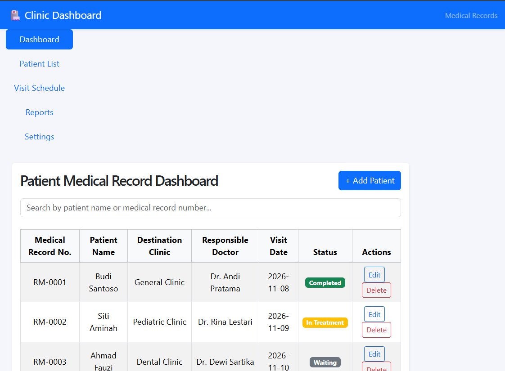
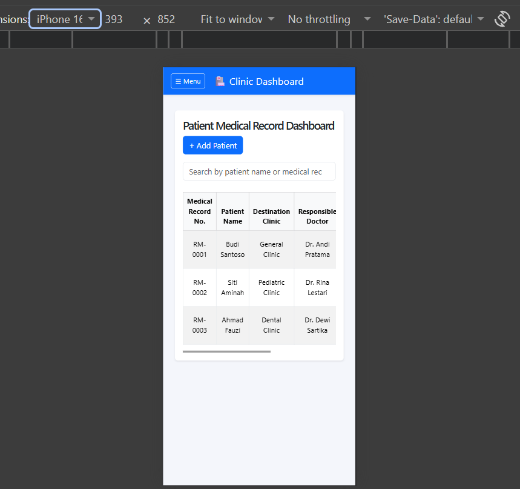

# Clinic Dashboard: Patient Medical Record

A client-side CRUD admin dashboard for managing patient medical records at a clinic. This project was built for Response 1 (Fullstack Programming), Case Study: Clinic / Hospital Patient Medical Record Dashboard.

## Features

- **Create, Read, Update, Delete** patient records through a modal form
- **Search** by patient name or medical record number (updates as you type)
- **Status badges** with colors based on treatment status (if/else logic)
- **Responsive layout**: fixed sidebar on desktop, slide-out menu on tablet and mobile
- **Hover transitions** on buttons, cards, and sidebar links
- **jQuery fade-in** effect on the patient table
- Data is stored in React state only (no backend or database)

## Technologies

- React 19
- Vite
- Bootstrap 5 and React-Bootstrap
- jQuery

## Project Structure

    src/
    ├── App.jsx              # Main layout, state, and CRUD logic
    ├── App.css / styles.css # Custom styles and responsive rules
    └── components/
        ├── Navbar.jsx       # Top navigation bar
        ├── Sidebar.jsx      # Desktop sidebar and mobile slide-out menu
        ├── Table.jsx        # Patient table with Edit and Delete actions
        └── FormModal.jsx    # Add and edit patient form

## How to Run

1. Install Node.js (v26.13.0 LTS or newer, with npm included) from https://nodejs.org/
2. Clone the repository:

        git clone https://github.com/abdulmajeed-cmd/clinic-dashboard.git
        cd clinic-dashboard

3. Install the dependencies:

        npm install

4. Start the development server:

        npm run dev

5. Open http://localhost:5173/ in your browser.

## Screenshots

**Desktop**

**Mobile**

## Notes

- The Visit Schedule, Reports, and Settings menu items are placeholders for future development.